# Alpine Fault, New Zealand: stochastic baseline for the simulator comparison

This example applies stochseis to a long fault with prescribed geometry,
segment slip rates and paleoseismic constraints: the Alpine Fault
simulator intercomparison (August 2025 setup). It shows how the model's
parameters shape the behaviour of a 760 km fault, and what the model
predicts once it is tuned to the paleoseismic records. The model class
and the general lessons are described in the top-level `README.md`. The
detailed development record (calibration rounds 1 to 7) is in the git
history of `docs/alpine.md` (removed 5 November 2026).

## 1. Setup

* **Geometries** (`data/nz_alpine/`, STL meshes in km NZTM, not in the
  repository): planar (755 km, dip 50 degrees, 20 km deep), variable dip
  (761 km; 80 degrees in the south, 50 in the centre, 55 to 85 in the
  north) and segmented transition (the variable-dip geometry with abrupt
  dip changes at segment ends), resampled onto 1 km ("fine") or 2 km
  ("coarse") patches.
* **Slip rates** (`data/nz_alpine/segments.csv`): 27 mm/yr in the south
  and centre, decreasing northward to 15, 5.5 and 4.9 mm/yr, blended over
  10 km at the segment boundaries.
* **Paleoseismic sites** (`data/nz_alpine/paleo_sites.csv`):

  | site | events | RI [yr] | CV | SED [m] (range) |
  |---|---|---|---|---|
  | south | 13 | 268 | 0.40 | 7.5 (7.0 to 8.0) |
  | central | 14 | 249 | 0.23 | 7.1 (4.5 to 8.5) |
  | north | 4 | 413 | 0.25 | 4.0 (1.0 to 9.4) |

* **Observation model** (`stochseis/sites.py`): an event is recorded at a
  site if its slip on the nearest surface patch reaches 2 m (1 m at the
  north site, whose record includes events of about 1 m); events closer
  than 30 yr are merged, as a paleoseismic record cannot separate them.

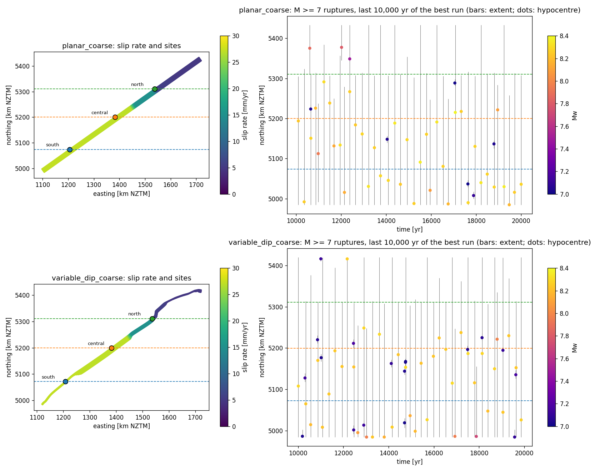

*Left: slip rate along the fault and the three sites. Right: M >= 7
ruptures over 10,000 yr of a calibrated run (bars: along-strike extent;
dots: hypocentres).*

## 2. Model class used here

Deficit-capped crack slip (`slip_mode = "local_cap"`), the hybrid size
rule (scale-free size hazard below `hazard_max_area_km2`, arrest by the
fault state above it), deficit-weighted nucleation, weak ETAS
clustering and the dip correction of crack amplitudes. Three other model
classes were tried and rejected on the constraints: crack slip set by
stress drop alone (site CV stays near 0.4 and above, north intervals too
long), slip equal to the local deficit (magnitude decouples from rupture
size, b of about 0), and strong clustering (branching ratio above about
0.3: irregular sites).

## 3. How the parameters shape a long fault

Realization sets vary one control at a time around a reference
calibration (`realization_sets.json`; variable-dip geometry, 2 km
patches, 50 realizations of 20,000 yr per case):

| set | control | cases |
|---|---|---|
| A | nucleation clock (exponent) | 3, 6, 12.3 (reference) |
| B | size rule (area threshold) | 100, 488 (reference), 2000 km^2 |
| C | quenched strength heterogeneity (50 km correlation) | ln-sigma 0 (reference), 0.5, 1.0 |
| D | barriers at the segment boundaries (passage control) | strength factor 1 (reference), 3, 10 |

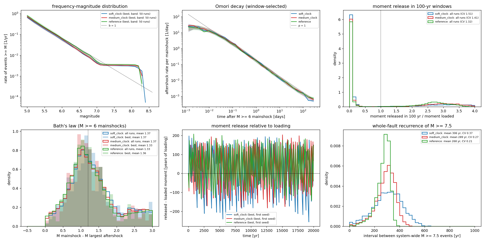

*Set A. The nucleation clock changes only the timing: the
frequency-magnitude distribution, Omori decay and Bath gap (1.33 to 1.37)
are the same in all cases, while whole-fault M >= 7.5 recurrence goes
from CV 0.21 (reference) to 0.37 (soft clock) and mean intervals from 268
to 306 yr.*

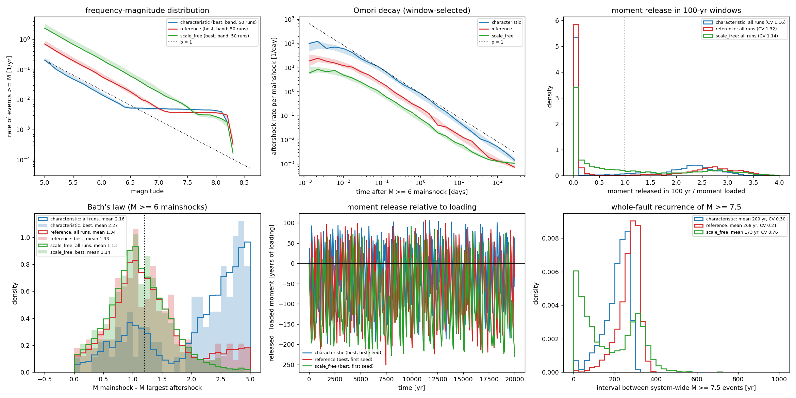

*Set B. The size rule changes everything together: the
frequency-magnitude distribution (a plateau from M6.5 in the
characteristic case, near Gutenberg-Richter to M7.5 in the scale-free
case), aftershock productivity, the Bath gap (2.16, 1.34, 1.13) and
whole-fault recurrence (CV 0.30, 0.21, 0.76; the scale-free case has
many pairs of large events in short succession).*

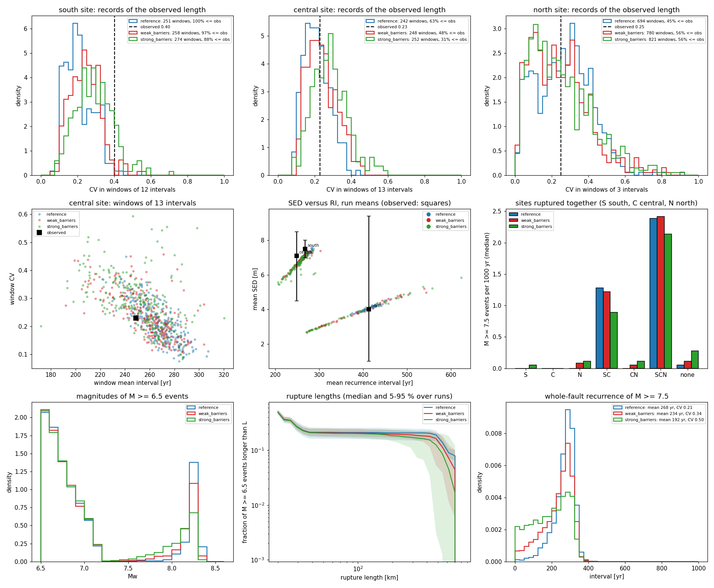

*Set C. Quenched barriers at 50 km scale make sites moderately less
regular (record-length CVs up to 0.28 to 0.29) and shorten north
intervals (318 to 342 yr), with fewer full-length ruptures; they do not
give the south and central sites different regularity.*

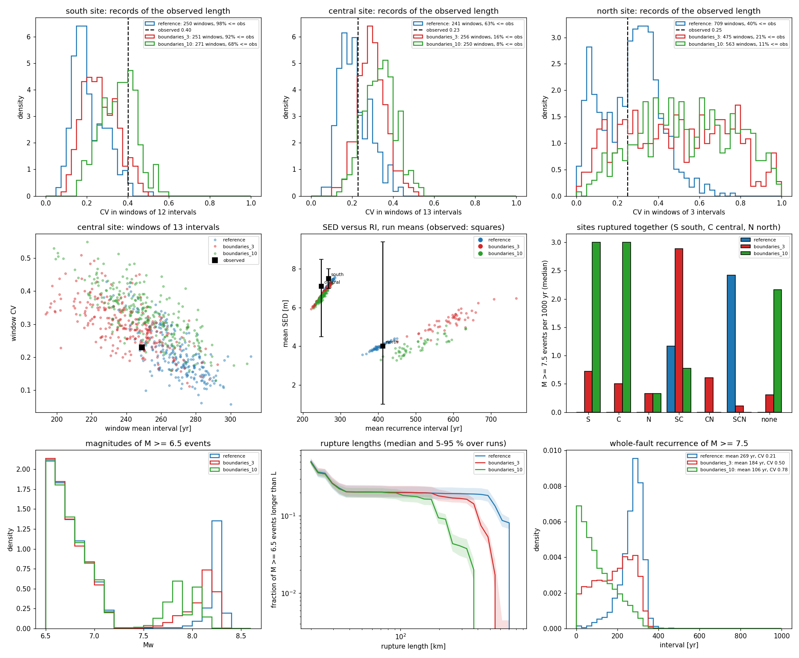

*Set D. Barriers at the segment boundaries (the analogue of a jump or
passage probability on this single-strand fault; the Jacksons boundary
lies between the south and central sites) decouple the sites: the
fraction of central-site M >= 7.5 events that also rupture the south
site falls from 1.00 to 0.73 (factor 3) and 0.21 (factor 10), and
full-length ruptures disappear. But both sites become less regular
together (record-length CVs: south 0.26 and 0.36, central 0.29 and 0.34),
the north site becomes very irregular (0.50 to 0.53) with long intervals
(about 490 to 570 yr), and whole-fault recurrence becomes irregular (CV
0.50 and 0.78). Decoupling removes the regularizing effect of long
ruptures everywhere at once, so it does not produce a regular central
next to a less regular south record.*

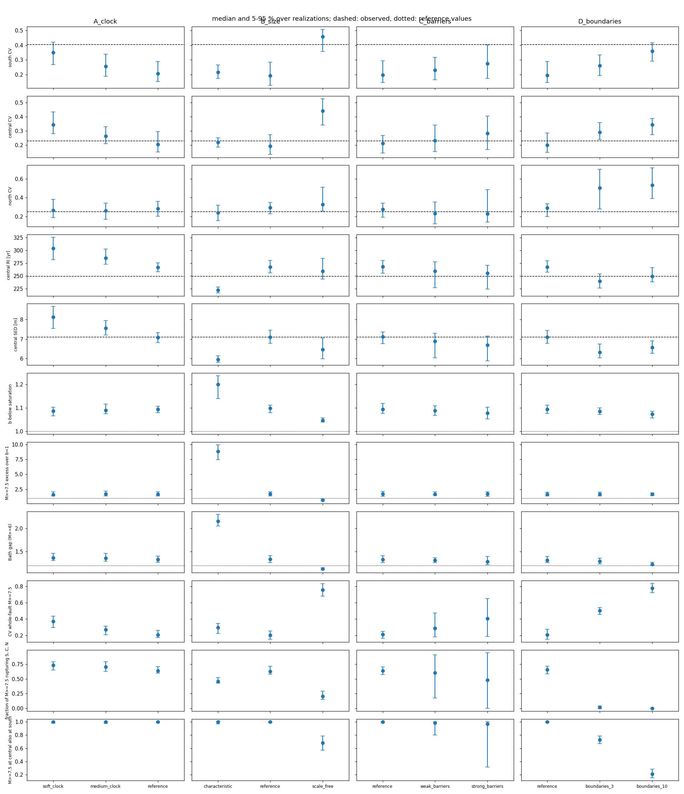

*All four sets in one figure: each statistic against the cases of each
set, median and 5 to 95 percent over realizations (dashed: observed).
Record-length window CVs at the three sites, central RI and SED, b, the
excess of M >= 7.5 events, Bath gap, whole-fault M >= 7.5 CV, the
fraction of M >= 7.5 events spanning all three sites, and the fraction
of central-site M >= 7.5 events also rupturing the south site.*

The same picture emerges from the 900 parameter vectors of the
calibration rounds 5 to 7 (`parameter_effects.py`; standardized
regression coefficients, metric standard deviations per parameter
standard deviation; `results/sets/parameter_effects.md`):

* site CV is raised mostly by the area threshold of the size rule (+0.60
  to +0.63 at the south and central sites) and the arrest scale (+0.25 to
  +0.52);
* mean intervals and displacements are set by stress drop (+0.57 to
  +0.70), the nucleation clock (-0.34 to -0.63) and the initiation rate
  (-0.24 to -0.33);
* co-rupture of the south and central sites is controlled by the arrest
  scale (-0.82);
* the Bath gap falls with the branching ratio (-0.41), b (-0.35) and the
  area threshold (-0.52); the excess of large events falls with the area
  threshold (-0.69);
* slip roughness and stress-drop scatter have no effect above 0.1.

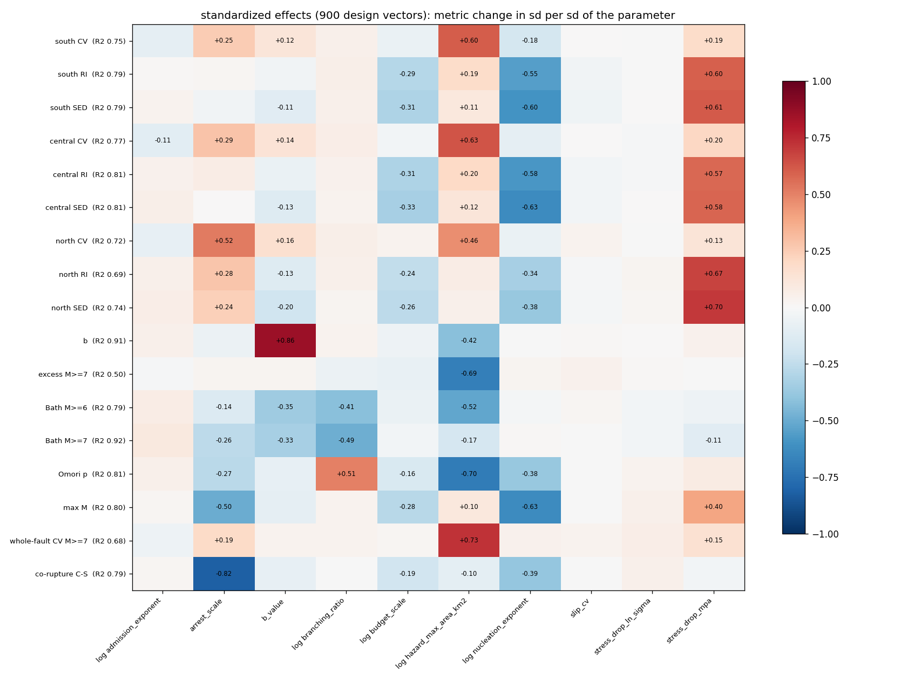

Other findings on this fault, from the calibration rounds:

* Geometry and resolution matter little: the three geometries give the
  same site statistics, event statistics and co-rupture within sampling
  error, and 1 and 2 km patches agree within 10 yr, 0.02 in CV and 0.2 m
  (`results/full_campaign/`).
* Large ruptures fall into two populations, shorter than about 60 km
  (up to M7.4) and through-going 400 to 700 km (M7.9 to 8.4); the events
  recorded at the sites are almost all of the second kind.
* Hypocentres concentrate at the base of the fault, where the deficit
  left by tapering crack slip accumulates; nothing in the rules places
  them there.
* Site records are slip-predictable: displacement correlates with the
  preceding interval (0.55 to 0.86 depending on the calibration) and
  little with the following one.
* The mean interval at the north site depends strongly on the detection
  threshold (depending on the calibration, 400 to 460 yr at 0.5 to 1 m,
  460 to 550 yr at 2 m, 750 to 850 yr at 4 m).

### 3.1 Typical sequences of contrasting cases

The panels below follow the layout used to compare the physics-based
models of the intercomparison: displacement, magnitude and interval
distributions at the three sites, the frequency-magnitude distribution,
hypocentre depths, rupture area against magnitude, and the site
statistics against the observations. Each page compares three cases
(variable-dip geometry, 2 km patches, 4 realizations of 20,000 yr per
case; `run_test.sh` redraws them from the 50-realization sets).
"Ensemble" curves and bands are over all realizations of a case; "best"
markers and curves show one realization of each case.

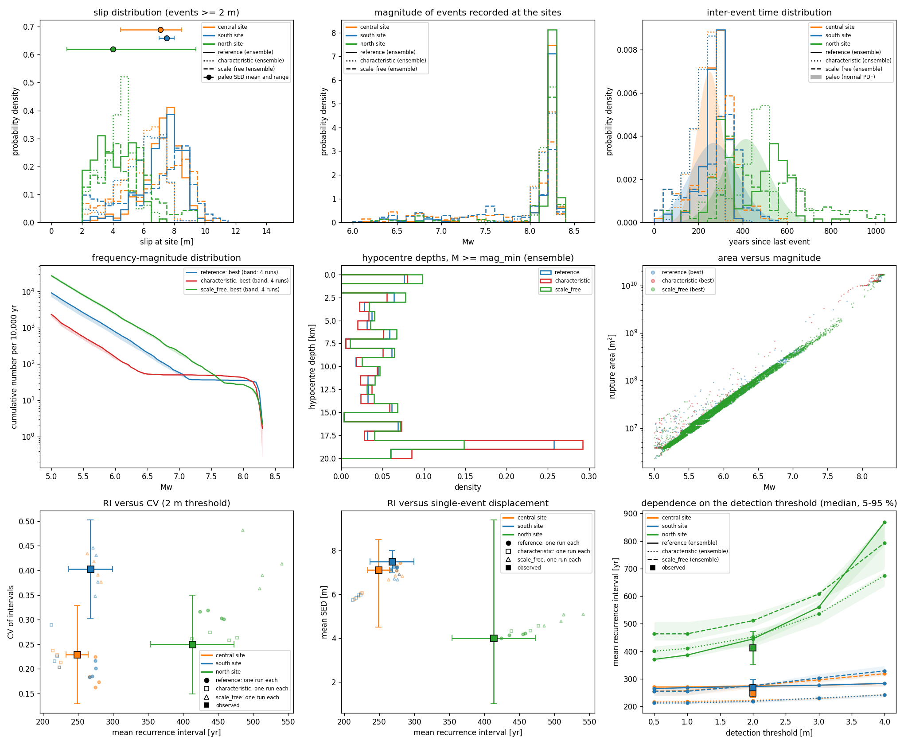

*Size rule. Characteristic sizes (area threshold 100 km^2): few moderate
events (a plateau from about M6.5), shorter intervals at the south and
central sites (about 220 yr) with smaller displacements (about 6 m), and
the strongest concentration of hypocentres at the base of the fault.
Scale-free sizes (2000 km^2): near Gutenberg-Richter statistics to M7.5,
broad interval distributions (CV about 0.40 at all sites), and longer,
more threshold-dependent north intervals (about 510 yr at 2 m). The
reference lies between them, with the most regular records (CV 0.18 to
0.19 at the south and central sites).*

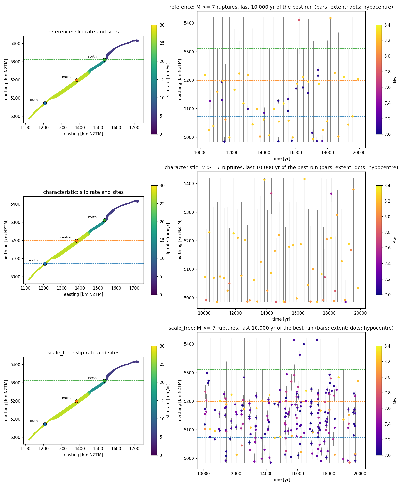

*M >= 7 ruptures over 10,000 yr of one realization per case (bars:
along-strike extent; dots: hypocentres, coloured by magnitude).*

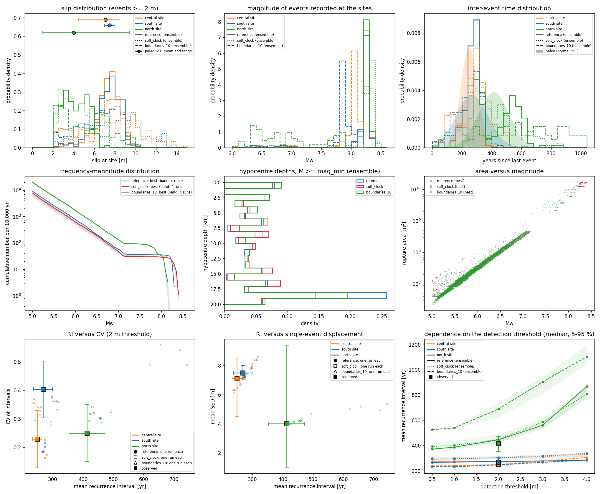

*Nucleation clock and segment-boundary barriers. The soft clock
(exponent 3) keeps the size distribution of the reference but makes
intervals longer and more variable (about 300 yr, CV about 0.35) and
displacements larger (about 8 m). Strong barriers (factor 10) give
segment-bounded ruptures: the south and central sites record mostly
different events, both with CV about 0.34, and the north site has long,
irregular intervals (about 690 yr, CV 0.52).*

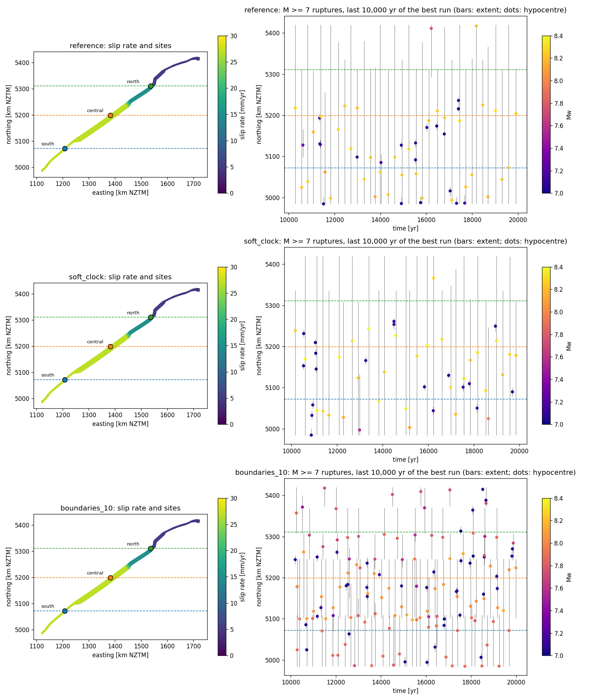

*Through-going ruptures in the reference and soft-clock cases; shorter,
more frequent, segment-bounded large ruptures with barriers at the
segment boundaries.*

## 4. The model tuned to the paleoseismic constraints

### 4.1 Calibration

Approximate Bayesian computation over the five configurations
(`run_full_campaign.sh`): 100 parameter vectors per round drawn from
priors, scored by the misfit of RI, CV and SED at the sites and the
b-value; the best 20 rerun as posterior ensembles. The accepted
parameter distributions are close to the priors: the site records select
the model class, not one parameter vector. Two calibrations are kept:

* **Reference (round 5,** `abc5_planar_l1.json`, `results/full_campaign/`):
  site envelope (fine configurations, 2 m, merged at 30 yr) south 261 yr /
  CV 0.37 / 6.8 m, central 269 / 0.35 / 6.9, north 546 / 0.37 / 4.8
  (about 440 to 490 yr at 1 m); Gutenberg-Richter to M7 with an excess of
  M7.3 to 8.0 events, Bath gap 1.43 to 1.47, whole-fault M >= 7.5 events
  every 171 to 177 yr (CV 0.63 to 0.65).
* **Regular sites (round 7,** `abc7_regularity.json`, `results/r7/`):
  area thresholds 50 to 500 km^2 and sharper nucleation clocks; best
  vector south 262 yr / 0.24 / 7.0 m, central 264 / 0.23 / 7.0, north
  417 / 0.32 / 4.1, at the cost of a characteristic size distribution
  (Gutenberg-Richter to about M6.8, then a plateau) and weak triggering.

A sensitivity round with stronger triggering (round 6, `abc6_bath.json`,
`results/r6/`) brings the Bath gap to about 1.0 but makes sites
irregular (CV 0.41 to 0.45) and lowers acceptance: regular sites and a
Bath gap of 1.2 are in tension in this model class.

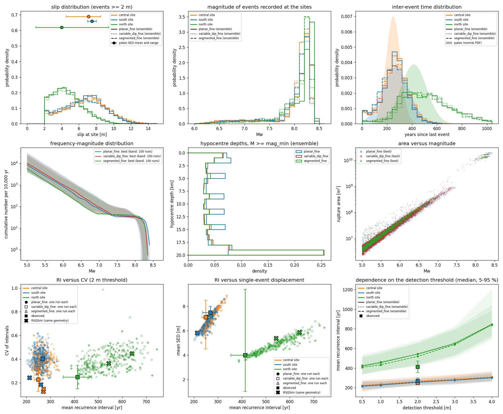

*Reference calibration, fine configurations: site displacement, magnitude
and interval distributions, frequency-magnitude distribution, hypocentre
depths, area-magnitude scaling, and the site statistics against the
observations.*

### 4.2 Matching records of the observed length

The observed CVs come from records of 4 to 14 events, and records of that
length drawn from the model are more regular than long runs (window CVs
about 0.07 lower). `record_match.py` therefore samples synthetic records
the way the real ones were collected (the last 13, 14 and 4 events at
the south, central and north sites before a common end time, every 100
yr) and counts how often they match the observed RI and CV at all three
sites at once (RI within two standard errors of the observed mean, CV
within two approximate standard errors). Mean match fraction per case
(50 realizations each):

| case | match | case | match | case | match | case | match |
|---|---|---|---|---|---|---|---|
| A soft clock | 1.5 % | B characteristic | 13 % | C reference | 16 % | D reference | 15 % |
| A medium clock | 8.5 % | B reference | 15 % | C weak barriers | 17 % | D boundaries x3 | 1.5 % |
| A reference | 16 % | B scale-free | 1.1 % | C strong barriers | 13 % | D boundaries x10 | 3.5 % |

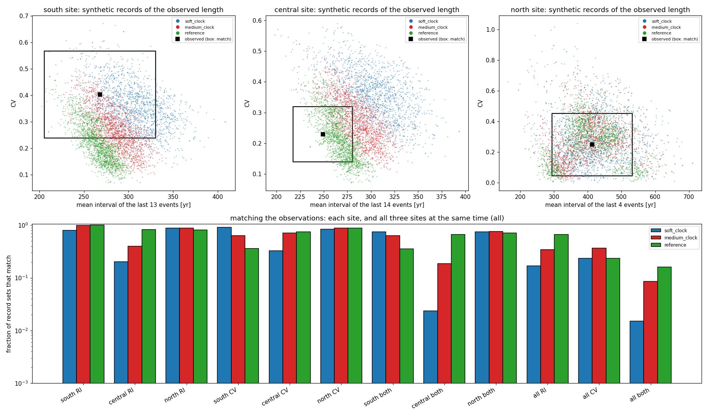

*Set A: RI and CV of synthetic records of the observed length at each
site, with the observations and their matching boxes (top), and the
fraction of record sets that match (bottom).*

* Mean intervals are easy to match once the budget is calibrated; CV is
  the discriminating observation.
* Regular models match the central record but rarely the irregular south
  record; irregular models do the reverse. In every case the south and
  central sites share more than 90 percent of their large ruptures, so
  the observed contrast between them is rare in all of them. Barriers
  at the segment boundaries separate the two sites but make both
  irregular, and the north record then fails (set D).
* The best-matching record sets of the reference case are close to the
  observations in every number (south 238 yr / 0.35, central 254 / 0.24,
  north 443 / 0.26; observed 268 / 0.40, 249 / 0.23, 413 / 0.25).

### 4.3 Predictions for the model comparison

`predictions.py` pools all cases and weights every realization by the
fraction of its records that match the constraints, so model classes
contribute in proportion to how well they fit; the weighted ranges are
the behaviour to be expected from purely stochastic models consistent
with the paleoseismic records (sets A to D, 12 cases, 600 realizations,
effective sample size 261; `results/sets/predictions.md`). The reference,
characteristic and strength-barrier cases carry 10 to 14 percent of the
weight each, the medium clock 7 percent, and the soft clock, scale-free
sizes and segment-boundary barriers 1 to 3 percent.

| quantity | constraint-weighted median [5-95 %] | all realizations |
|---|---|---|
| RI south [yr] | 261 [219-283] | 264 [220-305] |
| RI central [yr] | 263 [223-282] | 263 [223-303] |
| RI north [yr] | 408 [310-486] | 420 [310-596] |
| CV south | 0.24 [0.19-0.35] | 0.25 [0.18-0.44] |
| CV central | 0.23 [0.18-0.32] | 0.26 [0.18-0.43] |
| CV north | 0.31 [0.25-0.44] | 0.33 [0.25-0.62] |
| SED central [m] | 6.98 [5.93-7.48] | 6.95 [5.94-8.06] |
| whole-fault M >= 7.5 mean interval [yr] | 262 [164-283] | 260 [107-305] |
| whole-fault M >= 7.5 CV | 0.24 [0.18-0.58] | 0.29 [0.18-0.79] |
| maximum magnitude | 8.33 [8.27-8.45] | 8.33 [8.20-8.45] |
| b below saturation | 1.10 [1.07-1.20] | 1.09 [1.05-1.19] |
| M >= 7.5 excess over b = 1 | 1.76 [1.41-8.53] | 1.70 [0.70-8.41] |
| Bath gap (M >= 6) | 1.33 [1.25-2.15] | 1.32 [1.14-2.14] |
| fraction of M >= 7.5 rupturing all three sites | 0.62 [0.08-0.75] | 0.61 [0.00-0.79] |
| M >= 7.5 at the central site also at the south site | 1.00 [0.72-1.00] | 0.99 [0.21-1.00] |

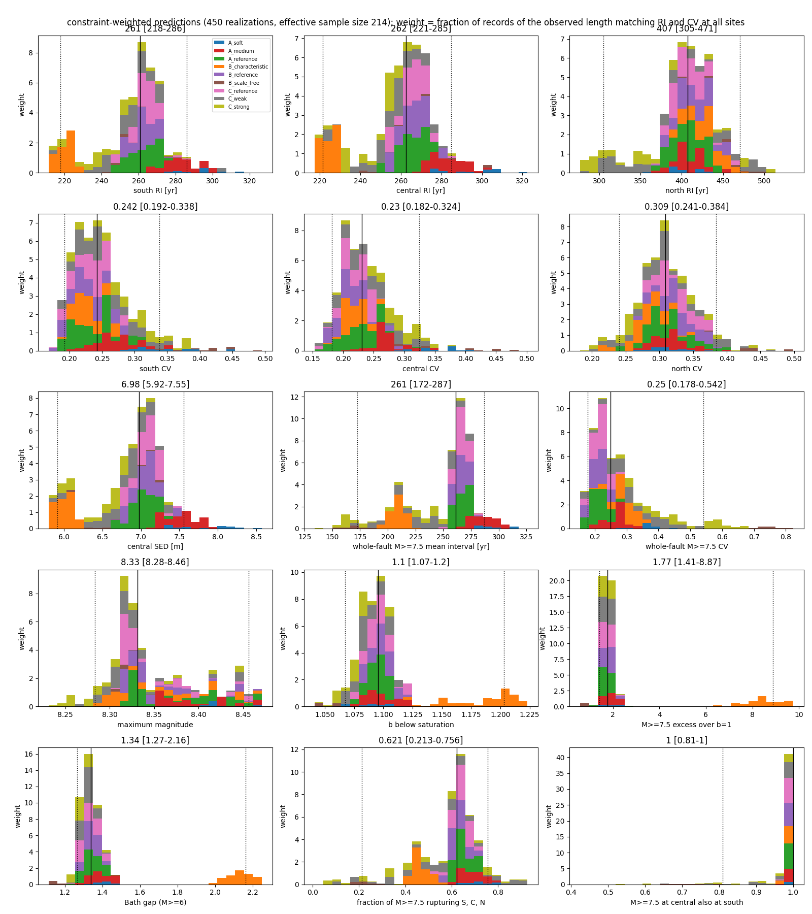

*Weighted distributions of each predicted quantity, stacked by case.*

Weighting by the constraints mainly removes the irregular cases (soft
clock, scale-free sizes) and narrows the upper tails of CV and
whole-fault irregularity. The constrained stochastic baseline predicts
regular large ruptures (whole-fault M >= 7.5 CV about 0.25), maximum
magnitudes of about 8.3, a moderate excess of large events over
Gutenberg-Richter, Bath gaps of 1.3 and more, and large ruptures that
mostly span the south and central sites together.

## 5. Open points for the comparison with physics-based simulators

A simulator demonstrates something beyond this baseline if it matches the
paleoseismic records together with:

* the contrast between a regular central and a less regular south record
  (not produced by any control tested here: clock, size rule, strength
  heterogeneity, segment-boundary barriers);
* regular sites with near-Gutenberg-Richter statistics and standard
  aftershock sequences (here, regular sites come with characteristic
  sizes and weak triggering);
* a mechanism for the controls this model imposes: the nucleation clock,
  the size rule and the deficit cap on slip.

Shared predictions a simulator can be checked against: slip-predictable
site records, hypocentres near the base of the seismogenic zone, and the
ranges in section 4.3.

## 6. Running

From the repository root, with the meshes in `data/nz_alpine/`:

    # set D, the control summary, pooled predictions and parameter effects (results/sets)
    examples/nz_alpine/run_test.sh $NR_CPUS alpine_sets 50 20000 alpine_full alpine_r6 alpine_r7

    # the realization sets A to D from scratch (about 12 core-hours) and their figure pages
    examples/nz_alpine/run_realization_sets.sh $NR_CPUS alpine_sets 50 20000

    # a calibration campaign (ABC, posterior ensembles, summaries, figures)
    examples/nz_alpine/run_full_campaign.sh $NR_CPUS alpine_r7 100 3 10000 20 5 20000 \
        "planar_coarse variable_dip_coarse" examples/nz_alpine/abc7_regularity.json

    # quick end-to-end checks (minutes)
    examples/nz_alpine/run_realization_sets.sh 1 alpine_sets_smoke 2 3000 A_clock
    examples/nz_alpine/run_full_campaign.sh 1 alpine_smoke 2 1 800 1 1 1000

Specs: `abc5_planar_l1.json` (reference calibration), `abc6_bath.json`,
`abc7_regularity.json`, `campaign_configs.json` (geometry and patch size
per configuration), `realization_sets.json` (sets A to D).

Scripts:

* campaign: `run_full_campaign.sh`, `make_campaign_specs.py`,
  `abc_scoring.py` (shared scoring), `abc_accept.py`,
  `make_posterior_spec.py`, `campaign_summary.py`;
* realization sets: `run_realization_sets.sh`,
  `make_realization_specs.py`;
* figure pages: `overview_figures.py` (page 1: seismicity statistics and
  recurrence), `nz_page.py` (page 2: site records in record-length
  windows, rupture patterns and sizes), `site_analysis.py` (page 3:
  intercomparison panels), `record_match.py` (page 4: matching records
  of the observed length), `spectrum_figures.py` (cases side by side);
* synthesis: `control_summary.py`, `predictions.py`,
  `parameter_effects.py` (parameter effects pooled over ABC rounds),
  `decompose_site_cv.py` (sources of site variability in one catalog).

A case is given to the figure scripts as a directory of catalogs, one
design vector of it (`dir:v0001`) or one realization (`dir:v0001_s5`).

Results kept in `results/`: `full_campaign/` (round 5, five
configurations, with `merge30/` tables), `r6/`, `r7/`, `sets/` (realization
sets: page-2, page-3 and page-4 tables, predictions, figures), `cases/`
(site and seismicity panels of contrasting cases).
