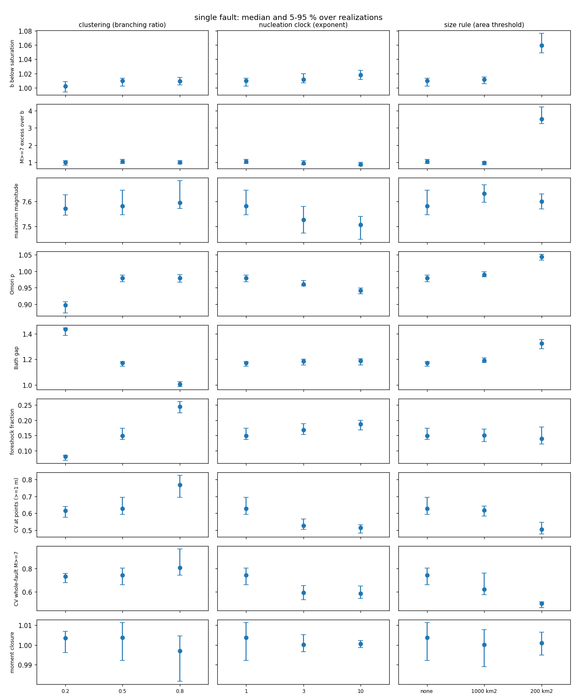
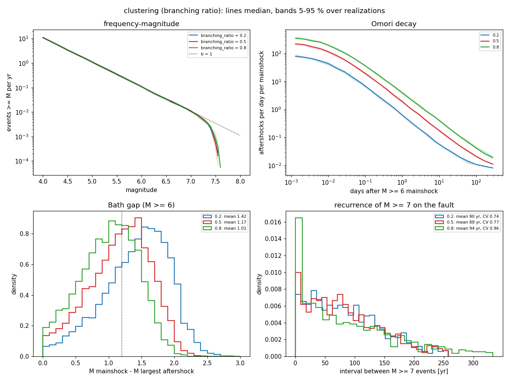
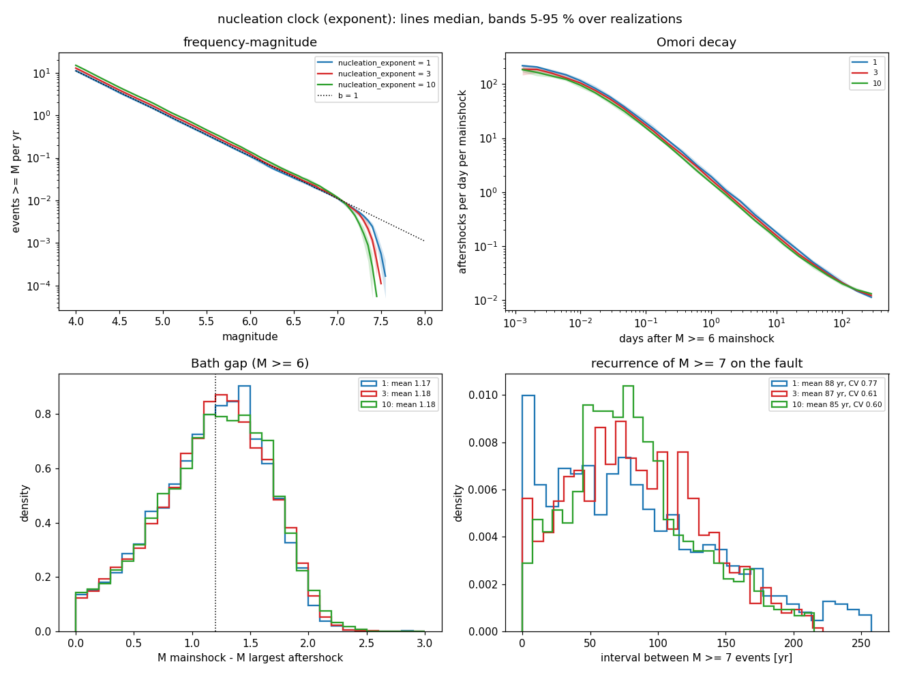
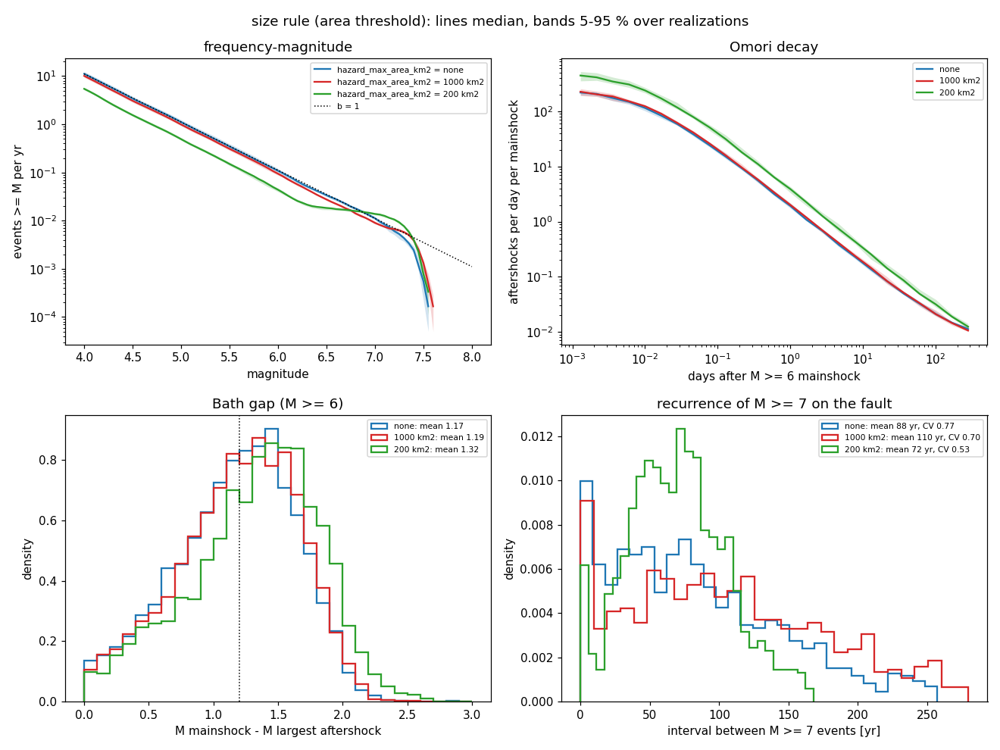
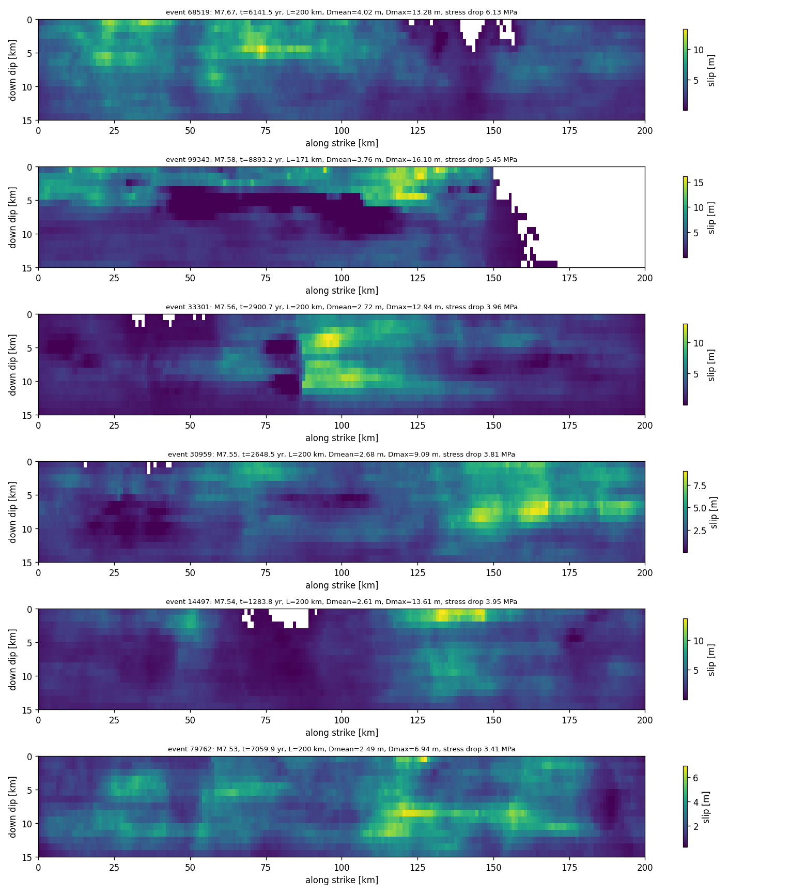

# Single fault: how a few parameters shape earthquake statistics

The simplest setting for stochseis: one planar, vertical, surface-breaking
strike-slip fault, 200 km long and 15 km deep, loaded at 20 mm/yr and
divided into 1 km patches, with the default parameters
(`docs/parameters.md`). This example shows what the model produces with
those defaults, and how three controls change the frequency-magnitude
distribution, aftershock statistics and recurrence, with the spread over
several realizations. The model itself is described in the top-level
`README.md`.

The figures in `figures/` and the numbers below come from 10
realizations of 10,000 yr per case (`run_test.sh`; table in
`figures/table.md`).

## 1. The overview

Seven cases (`specs/parameter_overview.json`): the defaults, and two
alternative values of each of three controls, one changed at a time.

| control | parameter | values (default in the middle or first) |
|---|---|---|
| clustering | `branching_ratio`, mean number of direct aftershocks per event | 0.2, **0.5**, 0.8 |
| nucleation clock | `nucleation_exponent`, how strongly nucleation favours high slip deficit | **1**, 3, 10 |
| size rule | `hazard_max_area_km2`, area above which ruptures stop only where the fault is not ready | **none**, 1000, 200 km^2 |

*Each column one control, each row one statistic; median and 5 to 95
percent over realizations. b: Gutenberg-Richter slope of grown ruptures
below width saturation; M >= 7 excess: rate of M >= 7 events relative to
the extrapolation of the small-event slope; Bath gap: mean magnitude
difference between M >= 6 mainshocks and their largest aftershock;
foreshock fraction: M >= 6 mainshocks preceded within 10 days and 10 km
by an event at most two units smaller (chance level about 0.15); CV at
points: coefficient of variation of the intervals between slip of 1 m or
more at points along the fault; CV whole-fault: of the intervals between
declustered M >= 7 events.*

Median over 10 realizations of 10,000 yr (5-95 % ranges in `figures/table.md`):

| case | b | M >= 7 excess | max M | Omori p | Bath gap | foreshock fraction | CV at points | CV whole fault, M >= 7 |
|---|---|---|---|---|---|---|---|---|
| defaults | 1.01 | 1.06 | 7.58 | 0.98 | 1.17 | 0.15 | 0.63 | 0.74 |
| branching 0.2 | 1.00 | 1.00 | 7.57 | 0.90 | 1.43 | 0.08 | 0.61 | 0.73 |
| branching 0.8 | 1.01 | 1.00 | 7.59 | 0.98 | 1.01 | 0.24 | 0.77 | 0.81 |
| clock 3 | 1.01 | 0.96 | 7.53 | 0.96 | 1.18 | 0.17 | 0.53 | 0.59 |
| clock 10 | 1.02 | 0.88 | 7.51 | 0.94 | 1.19 | 0.19 | 0.51 | 0.58 |
| size rule 1000 km^2 | 1.01 | 0.98 | 7.63 | 0.99 | 1.19 | 0.15 | 0.62 | 0.62 |
| size rule 200 km^2 | 1.06 | 3.51 | 7.60 | 1.04 | 1.32 | 0.14 | 0.50 | 0.50 |

The 5-95 % ranges over realizations are narrow (for example Bath gap
1.15 to 1.18, CV at points 0.59 to 0.69 with the defaults), so the
differences between cases are well resolved.

What each control does:

* **Clustering** sets the aftershock statistics: as the branching ratio
  goes from 0.2 to 0.8 the Bath gap falls from 1.43 to 1.01 and the
  foreshock fraction rises from 0.08 to 0.24 (chance level about 0.15).
  The stacked Omori p is lowest with weak triggering (0.90): with few
  aftershocks, background events inside the aftershock window flatten
  the decay. Strong triggering makes recurrence less regular (CV at
  points 0.77, whole fault 0.81). The size distribution does not change.
* **The nucleation clock** sets the regularity of recurrence (CV at points
  0.63 to 0.51, whole fault 0.74 to 0.58) and leaves b, the Bath gap and
  the size distribution unchanged; the largest events become slightly
  smaller (M7.58 to 7.51) because ruptures start before the deficit is
  high everywhere.
* **The size rule** sets the shape of the size distribution. With a
  200 km^2 threshold, ruptures that have grown past it run until the
  fault stops them, which produces a characteristic population of large
  events (3.5 times the Gutenberg-Richter rate at M >= 7) and, with it,
  more regular recurrence (CV 0.50 at points and on the whole fault), a
  larger Bath gap (1.32) and slightly steeper small-event statistics
  (b 1.06). A 1000 km^2 threshold (about 67 km of rupture on this 15 km
  wide fault) already makes whole-fault recurrence more regular (CV 0.62)
  without changing the size distribution visibly.

*Clustering (branching ratio 0.2, 0.5, 0.8).*

*Nucleation clock (exponent 1, 3, 10).*

*Size rule (no threshold, 1000 km^2, 200 km^2). Lines: median over
realizations; bands: 5 to 95 percent; histograms pooled over
realizations.*

## 2. What large ruptures look like

*The six largest events of the first realization with the defaults: slip over
the fault (along strike by down dip), with magnitude, length, mean and
maximum slip and stress drop. Slip is crack-shaped with self-affine
roughness; white areas did not slip (holes left by the arrest rule, or
the part of the fault the rupture did not reach).*

The same figure for the extreme case of each control:
[branching 0.8](figures/example_ruptures_branching_0.8.png),
[clock 10](figures/example_ruptures_clock_10.png),
[size rule 200 km^2](figures/example_ruptures_size_rule_200_km2.png).

## 3. What the development experiments established

The single-fault experiments E1 to E23 (`docs/experiments.md`, specs in
`experiments/`, summaries in `experiments/results/`) tested the building
blocks and the behaviour of the defaults:

* **Numerics.** Crack solutions agree with analytic results to about 1
  percent; statistics do not depend on patch size above the patch
  magnitude (E13) or on the initial state after a short burn-in (E14);
  the slip budget closes to within 1 to 2 percent (E2, E22).
* **Defaults** (E22, 20 realizations of 10,000 yr): b of 1.01 below width
  saturation and 1.28 above, maximum M7.6, Omori p 0.96, Bath gap 1.24,
  foreshocks before 33 percent of M >= 6 mainshocks against 15 percent
  by chance, CV at points 0.62 to 0.73, whole-fault M >= 7 CV 0.74.
* **Gutenberg-Richter has to be imposed.** Ruptures stopped only by the
  fault state produce characteristic size distributions, with or without
  quenched strength heterogeneity (E10, E17).
* **Moment-length scaling** follows L^1.5 for long ruptures; L^2 needs
  slip below the seismogenic depth (E18, E21).
* **Clustering** trades the Bath gap against regularity (E6); fault length
  has little effect on aftershock statistics (E7); segmented and dipping
  faults behave as expected (E15, E16); the free-surface treatment agrees
  with half-space solutions for vertical faults and gives up to 35
  percent too little slip for shallow thrusts without the dip correction
  (E20).
* **Hierarchical patches** (E23, planned): a persistent multi-scale patch
  structure (`hier_*` parameters) that makes rupture arrest points
  persistent; first runs and the planned sweep are in
  `docs/experiments.md`.

## 4. Running

From the repository root:

    # the overview: 7 cases x 10 realizations x 10,000 yr (about 1.5 core-hours), figures into figures/
    examples/single_fault/run_test.sh $NR_CPUS single_fault_out 10 10000

    # a quick check (minutes)
    examples/single_fault/run_test.sh 1 single_fault_smoke 2 1000 /tmp/single_fault_figures

    # the development experiments E5 to E22
    examples/single_fault/experiments/run_all.sh $NR_CPUS e_out

Files: `run_test.sh`, `make_figures.py` (figures and table from a sweep
directory), `specs/parameter_overview.json`, `figures/`, `experiments/`
(sweep specs of E5 to E22, `run_all.sh`, `run_stochseis_tests.sh`,
`aggregate_sweep.py`, `plot_sweep.py`, result summaries).
